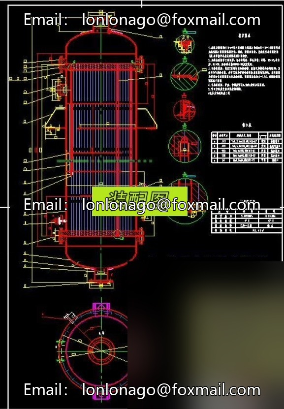
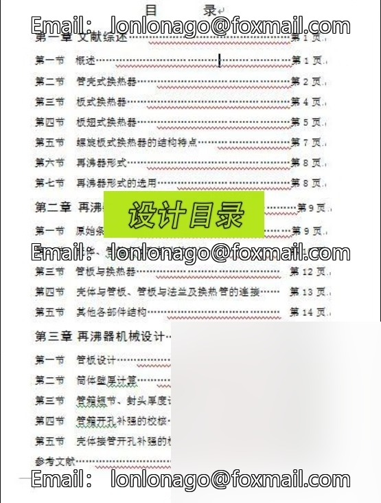

# Vertical heat-siphon recirculating boiler design vertical heat-siphon recirculating boiler design diagram vertical heat-siphon recirculating boiler design

## Body

Vertical heat rise-through reboiler design; vertical heat rise-through reboiler design diagram; vertical heat rise-through reboiler design CAD diagram
128    This document is the "vertical heat rise-through reboiler design"; specific design parameters: cylinder wall thickness 10 16MnR; tube-furnace inlet on-site receiving pipe φ325×12 16MnR; manifold head on-site receiving pipe of shell-furnace φ219×9.5 16MnR; short section thickness of tube manifold 10 16MnR, fixed tube plate thickness 50 1Cr18Ni9Ti. Other details refer to the design specification.

The material covers the design of a vertical hot siphon reboiler, its design drawings and CAD figures, including shaft wall thickness, tube inlet connections, tube box heads, shell inlet connections, tube box sections, fixed plates and other component design parameters.

<!-- AI_ENRICHED -->

## Images

## Payment

Here is a pay link on Stripe ( https://buy.stripe.com/3cs8yP7sY87d0vu9AB ). Please contact me lonlonago@foxmail.com after funding $89, and I will send you a complete data files , thank you!

